# Screenshots

Every major screen of every client, one folder per target. Regenerate with
`make clients` and then `screenshots/make-shots.sh [TARGET...]`; see the
script for the emulator settings.

The shots come from each client's offline **test mode**
(`clients/mekkogx/src/teststart.c`, `clients/intv/test.bas`,
`clients/astrocade/test.inc`), which jumps straight to a phase with a made-up
round-1 board: players PL0-PL3 and a generated map. Each screen is its own
scenario in `scenes/`. A target's own version of a scene, where its input or
timing differs, is in `scenes/<target>/`.

The **Atari 2600** has no test mode. Its shots come from a live game against
a private server, with three computer players, played by `emu/auto.lua`
(`make-shots.sh atari-2600`, about an hour). So its board, names and rounds
are real, and the screens it never stops on are missing.

"—" means the screen isn't reachable that way:
- **CoCo and Adam:** the ship has gone by the time the slow map draw or the
  tape load finishes.
- **Intellivision:** its test mode has no lobby.
- **Atari 2600:** the computer player sits out every good, so there is no
  declare screen, and the boot screens pass before the first snapshot.

| Screen | apple2 | atari | atari-2600 | coco | msdos-cga | msdos-pcjr | adam | msx | lynx | intv | astrocade |
|---|---|---|---|---|---|---|---|---|---|---|---|
| Title |  | [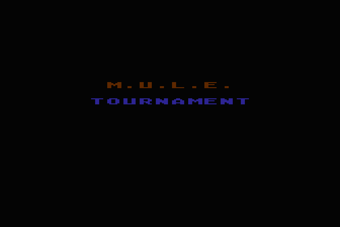](atari/01-title.png) | — | [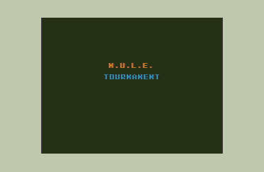](coco/01-title.png) | [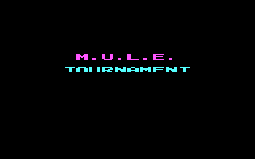](msdos-cga/01-title.png) |  | [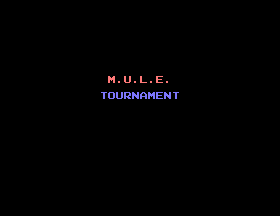](adam/01-title.png) | [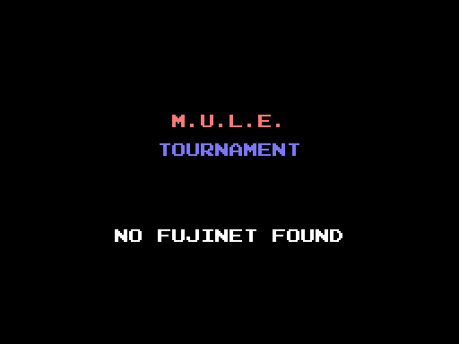](msx/01-title.png) | [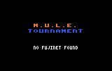](lynx/01-title.png) | [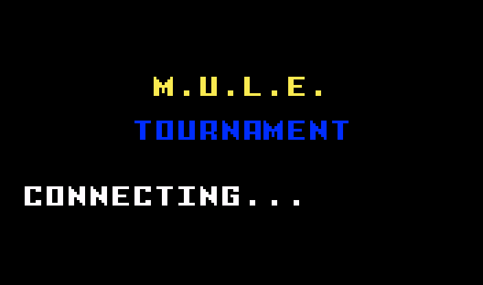](intv/01-title.png) | [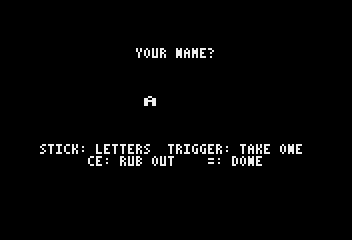](astrocade/01-title.png) |
| Lobby | [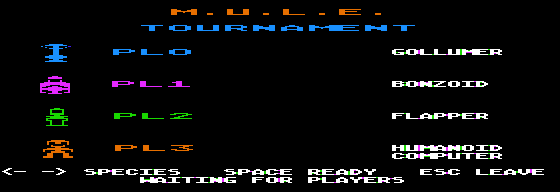](apple2/02-lobby.png) | [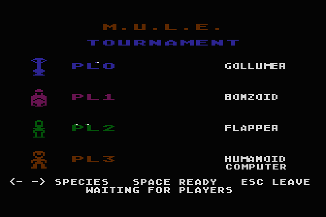](atari/02-lobby.png) | [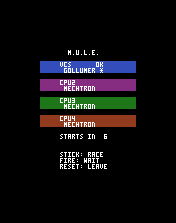](atari-2600/02-lobby.png) | [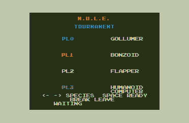](coco/02-lobby.png) | [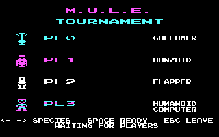](msdos-cga/02-lobby.png) | [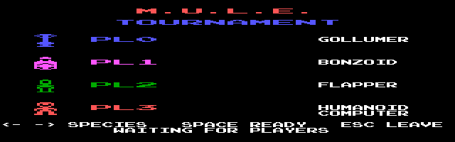](msdos-pcjr/02-lobby.png) | [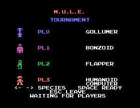](adam/02-lobby.png) | [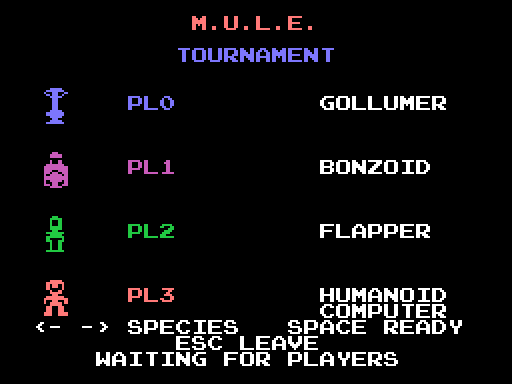](msx/02-lobby.png) | [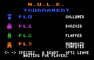](lynx/02-lobby.png) | — | [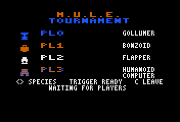](astrocade/02-lobby.png) |
| Status summary | [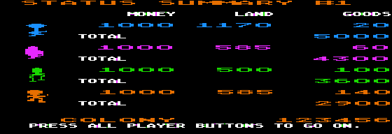](apple2/03-summary.png) | [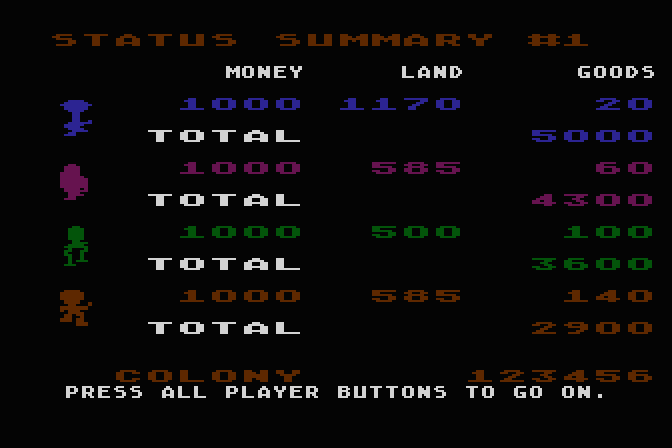](atari/03-summary.png) | [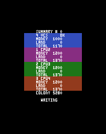](atari-2600/03-summary.png) | [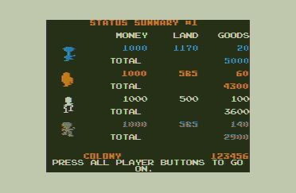](coco/03-summary.png) |  | [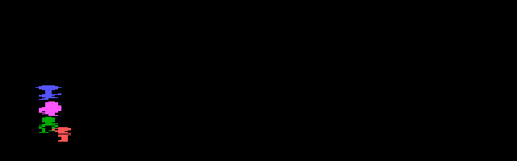](msdos-pcjr/03-summary.png) | [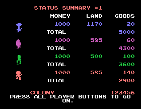](adam/03-summary.png) | [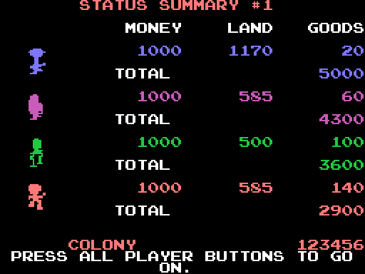](msx/03-summary.png) | [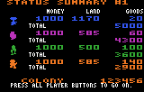](lynx/03-summary.png) | [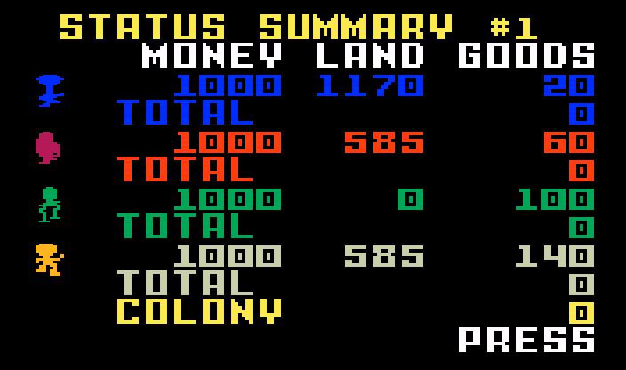](intv/03-summary.png) | [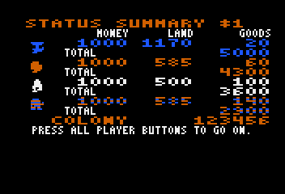](astrocade/03-summary.png) |
| Transport ship | [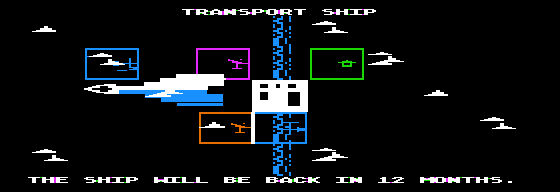](apple2/04-transport-ship.png) | [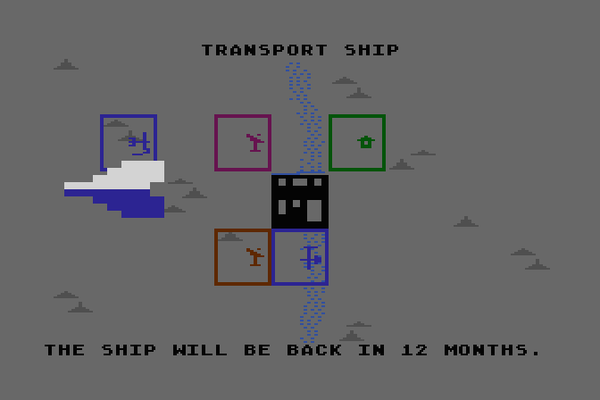](atari/04-transport-ship.png) | — | — | [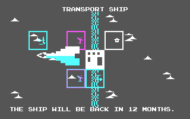](msdos-cga/04-transport-ship.png) | [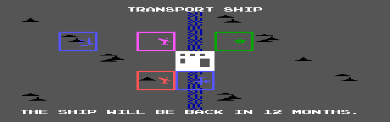](msdos-pcjr/04-transport-ship.png) | — | [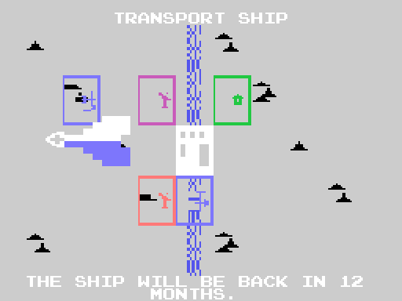](msx/04-transport-ship.png) | [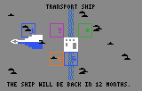](lynx/04-transport-ship.png) | [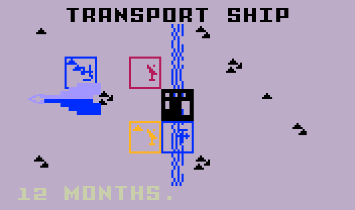](intv/04-transport-ship.png) | [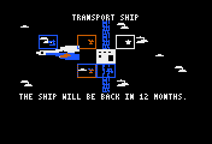](astrocade/04-transport-ship.png) |
| Land grant | [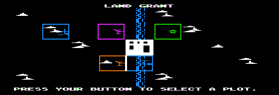](apple2/05-land-grant.png) | [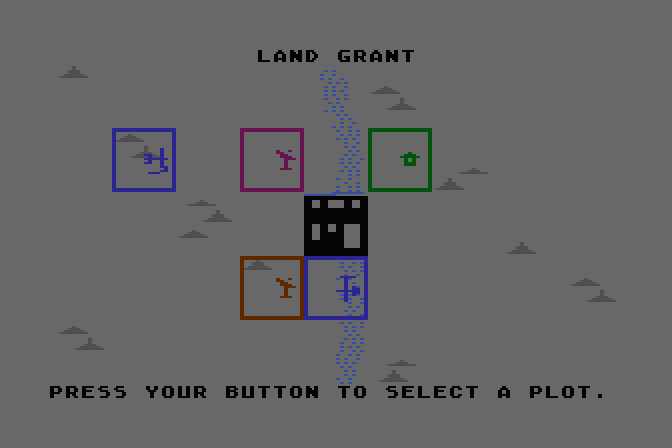](atari/05-land-grant.png) | [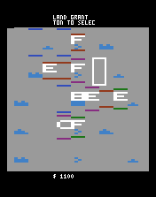](atari-2600/05-land-grant.png) | [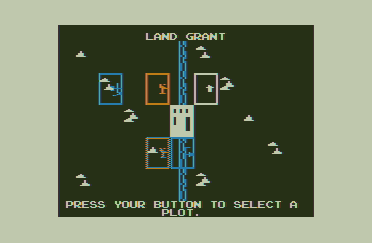](coco/05-land-grant.png) | [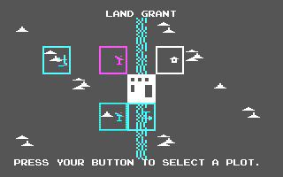](msdos-cga/05-land-grant.png) | [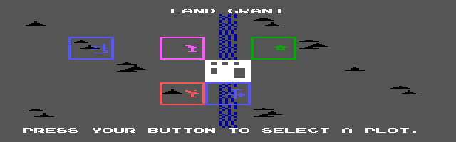](msdos-pcjr/05-land-grant.png) | [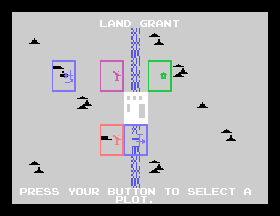](adam/05-land-grant.png) | [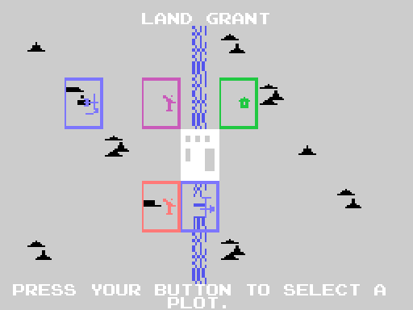](msx/05-land-grant.png) | [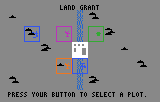](lynx/05-land-grant.png) | [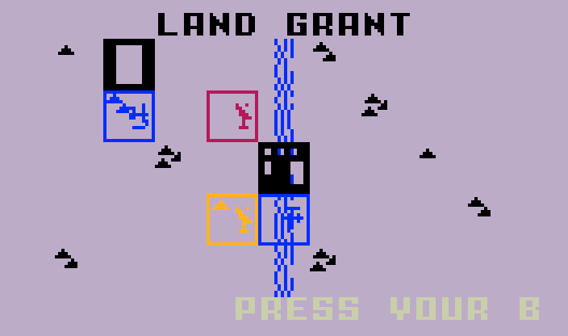](intv/05-land-grant.png) | [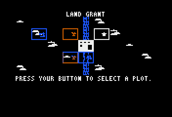](astrocade/05-land-grant.png) |
| Land auction (plot for sale) | [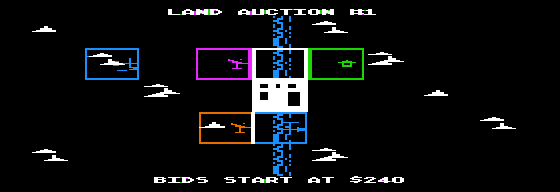](apple2/06-land-auction-show.png) | [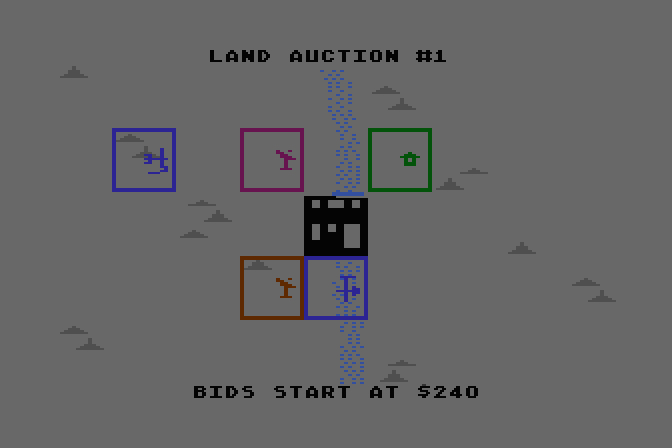](atari/06-land-auction-show.png) | [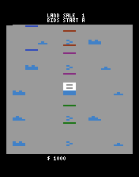](atari-2600/06-land-auction-show.png) |  |  |  |  |  |  |  |  |
| Land auction (bidding) |  |  |  |  |  |  |  |  |  |  |  |
| Development: town |  |  |  |  |  |  |  |  |  |  |  |
| Development: map |  |  |  |  |  |  |  |  |  |  |  |
| Player event |  |  |  |  |  |  |  |  |  |  |  |
| Production |  |  |  |  |  |  |  |  |  |  |  |
| Colony event |  |  |  |  |  |  |  |  |  |  |  |
| Goods status |  |  |  |  |  |  |  |  |  |  |  |
| Declare buyer/seller |  |  | — |  |  |  |  |  |  |  |  |
| Trading |  |  |  |  |  |  |  |  |  |  |  |
| Game over |  |  |  |  |  |  |  |  |  |  |  |

## Targets

- `apple2/`: Apple II (enhanced //e, MAME)
- `atari/`: Atari 400/800 (asim)
- `atari-2600/`: Atari 2600 (MAME + FujiNet cart, live game)
- `coco/`: TRS-80 Color Computer (MAME, artifact colours)
- `msdos-cga/`: MS-DOS, CGA (MAME 5150)
- `msdos-pcjr/`: MS-DOS, PCjr 16 colours (MAME)
- `adam/`: Coleco Adam (MAME, tape)
- `msx/`: MSX (openMSX)
- `lynx/`: Atari Lynx (MAME)
- `intv/`: Intellivision (jzIntv)
- `astrocade/`: Bally Astrocade (MAME + FujiNet cart)
